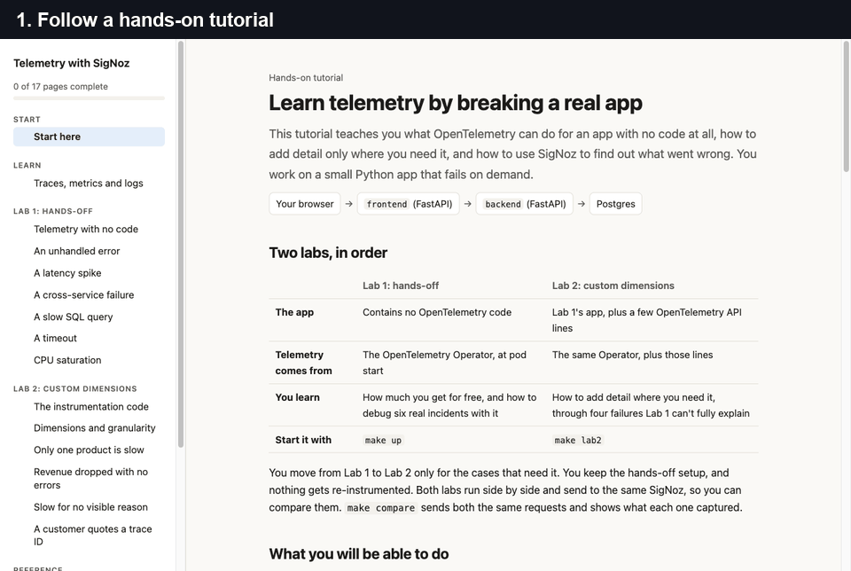
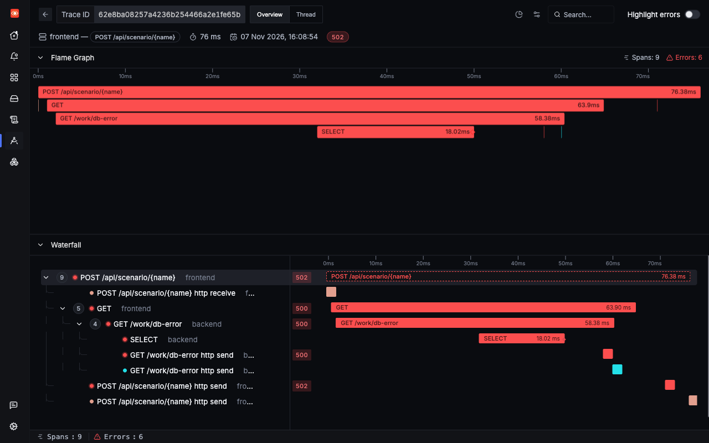
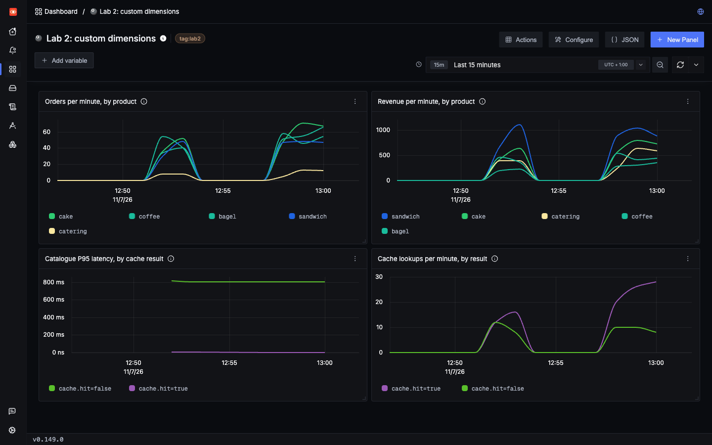
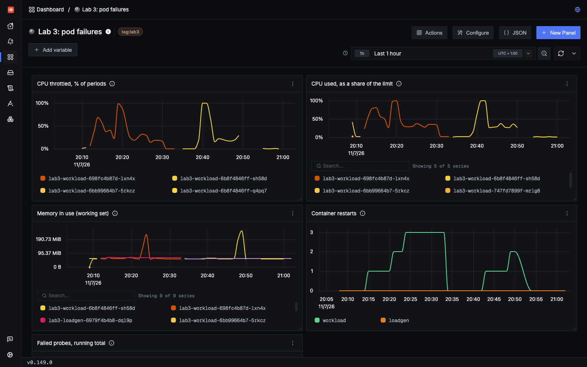
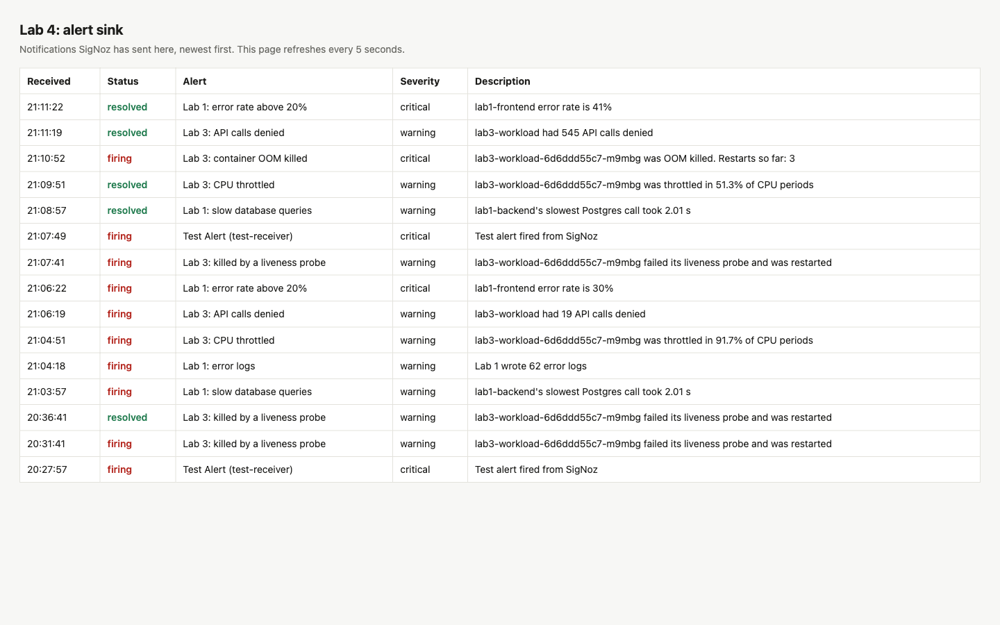

# OpenTelemetry Lab with SigNoz

[](https://github.com/vavdoshka/opentelemetry-signoz-lab/actions/workflows/e2e.yml)

A hands-on lab for learning OpenTelemetry on Kubernetes with SigNoz, the open source observability
platform. Get traces, metrics and logs from an app with no code changes, debug real incidents, add
custom dimensions only where you need them, watch the Kubernetes underneath, and get alerted when it
breaks. One command, on k3d or kind.



| Lab | What you do | What you learn | Start it |
|---|---|---|---|
| **1. Hands-off** | Get telemetry from an app with no OpenTelemetry code | How much you get for free, through six incidents | `make up` |
| **2. Custom dimensions** | Add a few OpenTelemetry API calls, only where they help | How to slice telemetry by things only your code knows, through four incidents | `make lab2` |
| **3. Kubernetes** | Run a workload with real limits, and scrape the kubelet, cAdvisor and API server | How to debug throttling, OOM kills and failed probes, through five incidents, and which metrics quietly miss them | `make lab3` |
| **4. Alerts** | Add eight alert rules, and a page showing what they send | How to write alerts that fire for real failures, and how long they take | `make lab4` |

Each lab builds on the one before and adds only what it needs. They run side by side on a local
two-node cluster and send to the same SigNoz.

An interactive tutorial walks you through all of it: 26 pages, with buttons that trigger real
failures, 89 saved searches, and code quoted straight from this repo.

## What you'll learn

**Lab 1: get telemetry with no code**

- Get traces, metrics and logs from a Kubernetes app with one annotation, using the OpenTelemetry
  Operator
- How auto-instrumentation works, and how it can fail silently
- Read a distributed trace across services, down to the SQL statement
- Link logs to traces, and use plain log fields as free dimensions
- Debug six real incidents: an unhandled error, a latency spike, a cross-service failure, a slow SQL
  query, a timeout and CPU saturation
- Write SigNoz searches for traces, logs and metrics

**Lab 2: add detail only where you need it**

- Add custom spans, attributes and metrics on top of auto-instrumentation, with no SDK setup
- Choose between a log field, a span attribute and a metric label
- Avoid high-cardinality metrics, with measured numbers
- Solve failures that auto-instrumentation can't fully explain: one slow product, lost revenue with no
  errors, and random-looking slowness
- Give users a trace ID they can quote to support
- Build a SigNoz dashboard around your own dimensions

**Lab 3: watch what your app runs on**

- See CPU throttling, which average CPU hides, and how it can get a healthy pod killed
- Find an OOM kill, when the metric named after it reads 0
- Read pod, node, kubelet and API server metrics, and tell a pod problem from a node problem
- Scrape Prometheus endpoints into SigNoz with a keep-list, and see what that costs
- How k3s differs from a real API server
- See what collects what, and why there's no node-exporter or kube-state-metrics

**Lab 4: get told when it breaks**

- Write metric, trace and log alerts, including one that fires when data stops arriving
- Choose a signal that really sees the failure, and a threshold above your normal
- Send notifications through a webhook, and measure how long they take
- Automate dashboards and alerts with a service account, instead of a password

**Running it for real**

- Run node agents for pod metrics, container logs and Kubernetes events
- What a plain SigNoz install leaves out, and how to fill the gaps
- When to sample, and what sampling costs you
- What survives a node crash, and what doesn't

## See it

| A failing request, traced down to the SQL | A dashboard built on custom dimensions |
|---|---|
|  |  |

| Throttling, restarts and OOM kills | Alerts from real failures |
|---|---|
|  |  |

## Prerequisites

| Tool | macOS | Linux |
|---|---|---|
| Docker | [Docker Desktop](https://docs.docker.com/desktop/setup/install/mac-install/) | [Docker Engine](https://docs.docker.com/engine/install/) |
| k3d (or kind) | `brew install k3d` | [Install k3d](https://k3d.io/#installation) |
| kubectl | `brew install kubectl` | [Install kubectl](https://kubernetes.io/docs/tasks/tools/) |
| Helm | `brew install helm` | [Install Helm](https://helm.sh/docs/intro/install/) |
| Python 3.9 or newer | `brew install python` | Usually already installed |
| make | `xcode-select --install` | `sudo apt install make` |

You also need:

- **Memory:** at least 8 GB for Docker, and 10 GB is better. On Docker Desktop, set this in
  Settings > Resources. Labs 1 and 2 use about 4.5 GiB, mostly ClickHouse, and all four labs use about
  5.2 GiB.
- **CPU:** about 0.3 core idle in the cluster, but Docker Desktop's VM can use over 1.5 cores under
  load on a Mac. Stop the load generator when you aren't using it, and run `k3d cluster stop signoz-lab`
  between sessions. `make up` brings it back.
- **Port 8080** free on your machine.

Run `make check` to confirm everything is ready. It tells you how to fix anything that isn't. On
some Linux machines it will ask you to add one line to `/etc/hosts`.

## Quick start

```bash
git clone https://github.com/vavdoshka/opentelemetry-signoz-lab.git
cd opentelemetry-signoz-lab
make up
```

The first run downloads several images, so allow about 5 to 10 minutes. It finishes with a smoke test
that proves traces, logs and metrics are reaching SigNoz.

Then start the tutorial, which takes it from there:

```bash
make tutorial  # then open http://127.0.0.1:8765
```

Add the other labs when you reach them:

```bash
make lab2      # custom dimensions
make compare   # sends Labs 1 and 2 the same requests and shows what each captured
make lab3      # Kubernetes
make lab4      # alerts. Needs Lab 3
```

| What | Where |
|---|---|
| Tutorial | http://127.0.0.1:8765, after `make tutorial` |
| SigNoz | http://signoz.localhost:8080 (the generated login is in `.lab-credentials`) |
| Labs 1 to 3 | http://lab1.localhost:8080, and `lab2`, `lab3` in the same form |
| Alerts received | http://lab4.localhost:8080 |

Start the load generator on a lab's page, so SigNoz has data to show, and stop it when you finish.

## Commands

| Command | What it does |
|---|---|
| `make check` | Checks the prerequisites |
| `make up` | Creates the cluster and deploys SigNoz and Lab 1. Safe to rerun, and recovers the lab after a restart |
| `make lab1` | Redeploys Lab 1 after you change its code |
| `make lab2` | Deploys Lab 2 and its SigNoz dashboard, or redeploys it after you change its code |
| `make lab3` | Deploys Lab 3, its extra scrape jobs and its dashboards |
| `make lab4` | Deploys Lab 4's alert sink and rules, and proves a notification gets through. Needs Lab 3 |
| `make compare` | Shows what SigNoz captures from Labs 1 and 2 |
| `make status` | Shows nodes, pods and URLs |
| `make tutorial` | Runs the interactive tutorial |
| `make down` | Deletes the cluster and all its data |

k3d is the default. To use kind, run `make up PROVIDER=kind`. The other commands find the running
cluster themselves.

## The test apps

Labs 1 and 2 run the same app: `frontend → backend → Postgres`, two Python FastAPI services that send
telemetry through the SigNoz agent on their node. Lab 2 runs two replicas of each, one per node. The
UI has a button for each scenario:

| Scenario | What it does |
|---|---|
| `order`, `list` | Normal requests through to Postgres |
| `slow` | Backend sleeps 1–3 s |
| `slow_query` | `SELECT pg_sleep(2)` |
| `timeout` | Backend takes 3 s, frontend gives up after 1 s (504) |
| `bad_input` | Handled 400 with a warning log |
| `crash` | Unhandled exception in the frontend (500) |
| `backend_500` | Unhandled exception in the backend, frontend returns 502 |
| `db_error` | Query on a missing table |
| `cpu_burn` | Burns CPU for N seconds, visible in pod metrics |
| `log_burst` | N log lines at a chosen level |
| `slow_item` | Five orders. One product is slow, and nothing fails |
| `free_orders` | Five orders with a coupon. Everything succeeds, but revenue is zero |
| `cache_miss` | Six catalogue lookups. Some are slow, for no visible reason |

The last three are the point of Lab 2. Both apps have those bugs, but Lab 1 can only show the
symptoms. Lab 2 adds the dimensions that explain them.

Lab 3 runs a separate workload with real limits and a liveness probe. Each scenario makes Kubernetes
step in:

| Scenario | What it does |
|---|---|
| `throttle` | Burns more CPU than the limit allows, so the kernel throttles the container |
| `oom` | Leaks memory until the kernel kills the container |
| `liveness` | Makes `/healthz` fail, so the kubelet restarts the container |
| `disk` | Writes 512 MiB to the node's disk, then removes it |
| `api_flood` | Lists pods from the API server up to 20 times a second |
| `api_denied` | Asks the API server for secrets it isn't allowed to read |

Lab 4 adds no app of its own. Its rules watch Labs 1 and 3, so these same scenarios set them off.

## Use it on your own cluster

Everything in Labs 3 and 4 is scripted, so you can reuse it. The metrics are a Helm values file and an
RBAC manifest. The dashboards and alerts come from two scripts that work on any SigNoz, with a service
account's key:

```bash
export SIGNOZ_URL=https://signoz.example.com
export SIGNOZ_API_KEY=...   # a service account's key, with the signoz-editor role

python3 scripts/create_dashboard.py 3
python3 scripts/create_alerts.py
```

They're safe to run repeatedly. The tutorial's **Automate it** page covers what to change, which roles
you need, and three traps that pass unnoticed in a pipeline.

## What we found

Every claim here comes from causing the failure and reading what each signal did. Some of the results
were surprises:

- **`container_oom_events_total` read 0 through a real OOM kill.** Only restarts grouped by
  `last_terminated_reason` showed it.
- **Memory against limit misled both ways.** It read 99.5% during a harmless file write, because it
  counts page cache, and 86% just before a real kill.
- **Average CPU hid throttling.** A pod showing 23% of its limit was throttled in 19 to 32% of its CPU
  periods. With a little more load, the same limit got a healthy pod killed by its liveness probe.
- **549 denied API calls never reached `apiserver_request_total`,** on k3s 1.26. The app's own client
  spans showed all of them.
- **Alerts took about 4 minutes to arrive,** and that's by design: SigNoz reads data that's 2 minutes
  old, so late data can land.

The full write-ups:

- **[Findings](docs/FINDINGS.md):** what works with no configuration, what doesn't, what custom
  dimensions add, Kubernetes coverage, alert timings, resource use and a node crash test.
- **[Benchmark](docs/BENCHMARK.md):** the lab scored against OpenTelemetry and SigNoz guidance.
- **[Configuration log](docs/CONFIG.md):** every non-default setting, and why.

## Tested on

| Platform | Provider | Labs 1 and 2 | Labs 3 and 4 |
|---|---|---|---|
| macOS, Apple Silicon | k3d 5.5.0 | Yes | Yes, every scenario and alert |
| macOS, Apple Silicon | kind 0.22.0 | Yes | Not tested |
| Ubuntu, x86 (the e2e workflow) | k3d 5.9.0 | Yes | Yes, scrape jobs and one real alert |
| Ubuntu, x86 (the e2e workflow) | kind 0.33.0 | Yes | Yes, scrape jobs and one real alert |

"Yes" for Labs 1 and 2 means they boot from nothing and `make compare` gives the same results.
Rerunning `make up` is tested in the e2e workflow and on k3d on macOS. Recovery after stopping the
cluster is tested on k3d on macOS, with Labs 1 and 2. Other platforms, including Windows and Linux on
ARM, are untested.

## Troubleshooting

**Something broke after a restart.** Run `make up`. It restarts the cluster and reapplies what a
restart loses. Test orders are lost, because Postgres has no persistent volume, but SigNoz keeps its
data.

**You created the SigNoz admin yourself.** The smoke test and tutorial need that login. Save it in
`.lab-credentials`:

```
SIGNOZ_EMAIL=you@example.com
SIGNOZ_PASSWORD=your-password
```

**A dashboard says "No data in this time range".** The Pod dashboard's namespace selector starts on
`default`, which has no pods. Choose `lab3` at the top of the page.

**An alert hasn't arrived.** Allow about 4 minutes, or about 6 for `telemetry stopped`. That one
arrives as `[No data] Lab 3: telemetry stopped`.

**Pods fail with "too many open files" on Linux.** Raise the inotify limit:
`sudo sysctl fs.inotify.max_user_instances=1024`.

## Limits

This is a lab, not a production setup. It runs on one machine, and ClickHouse, ZooKeeper, Postgres
and the control plane each run as a single instance. The findings cover what production would need.

## Licence

[MIT](LICENSE). SigNoz is a separate project with its own licence. This repo installs it from
SigNoz's official Helm charts and doesn't include it.
